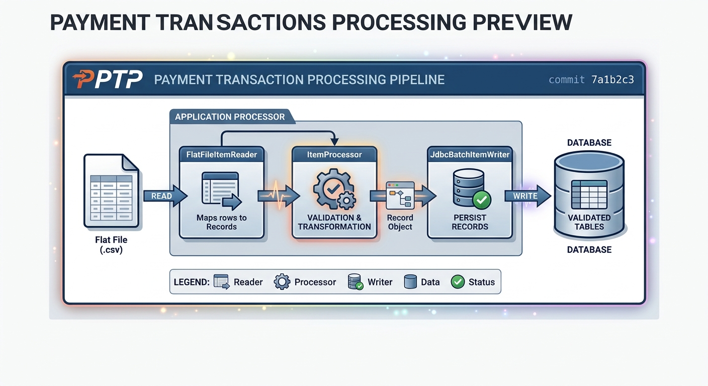

# Batch Payment History Processor

Reads fixed-width payment history records, transforms transaction data with Spring Batch, and stores the results in an in-memory H2 database.

## Application Preview



> **Implementation note:** The illustration is conceptual. The current job skips the first input line, processes the remaining fixed-width records in chunks, and persists them through Spring Data JPA. It does not yet validate separate header, body, or trailer records.

## Features

- Reads the bundled `src/main/resources/input.csv` file with a fixed-width tokenizer.
- Processes records in Spring Batch chunks of 10.
- Maps input fields, uppercases card types, and formats balances as USD.
- Saves processed records to an in-memory H2 database using Spring Data JPA.
- Starts a batch run through `POST /batch/run` (or `GET /batch/run`).
- Exposes the H2 console at `/h2-console` while the application is running.

## Installation

### Requirements

- Java 21
- Maven, or the included Maven Wrapper

### Build and run

1. Clone the repository:

   ```sh
   git clone https://github.com/hamza-haddougui/batch-payment-history-processor.git
   cd batch-payment-history-processor
   ```

2. Build the application:

   ```sh
   # macOS/Linux
   ./mvnw clean package

   # Windows PowerShell
   .\mvnw.cmd clean package
   ```

3. Start the service:

   ```sh
   # macOS/Linux
   ./mvnw spring-boot:run

   # Windows PowerShell
   .\mvnw.cmd spring-boot:run
   ```

4. In another terminal, launch the batch job:

   ```sh
   curl -X POST http://localhost:8080/batch/run
   ```

The service listens on port `8080`. The input file is packaged with the application, and the in-memory database is reset when the application stops.

## Contributing

PRs welcome 🎉.

1. Fork the repository.
2. Create a new branch (`git checkout -b feature-branch`).
3. Commit your changes (`git commit -m 'Add some feature'`).
4. Push to the branch (`git push origin feature-branch`).
5. Open a Pull Request.

## License

This project is licensed under the MIT License. See [LICENSE](LICENSE) for details.
